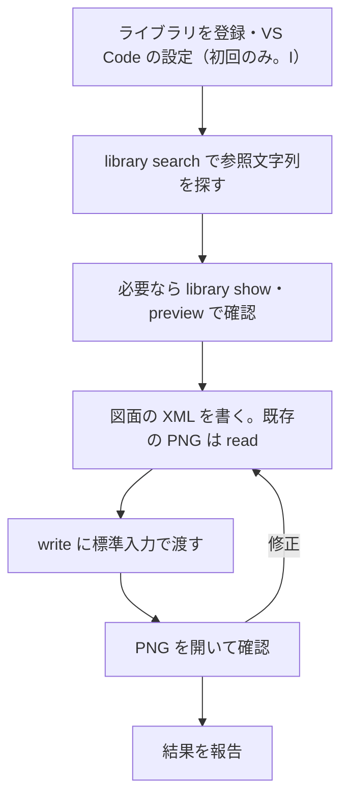

# v0.2.0 のユースケース: XML を標準入力で渡して図形・アイコンを配置・編集する

この文書は、[v0.2.0 の仕様](spec.md)を使ってエージェントが図面を作る・直す流れを、ユースケースごとに示す。各ケースで **CLI に渡す XML** と、**CLI がない場合に書く必要がある XML** を並べ、比較できるようにした。

- **CLI に渡す XML**: エージェントが書いて `d-png-cli write` の標準入力などに渡す XML。登録ライブラリの部品は `dpng-ref="…"` と `image=lib:…` で参照する。
- **CLI がない場合の XML**: 同じ図面を、ライブラリの参照なしで draw.io の普通の XML として書いたもの。エージェントがライブラリのファイルを読み、style・画像・ID・座標を自分で写して組み立てる必要がある。`d-png-cli expand` の出力、つまり `write` が PNG に埋め込む XML と同じ内容である。

B〜G は、v0.1.0 で `insert` を使わずに XML を編集する手順・v0.2.0 の前に計画した参照機能の手順と比較したときと同じ依頼・同じ比較用ライブラリを使う（どちらの比較資料もこのリポジトリには含めていない）。A は draw.io の図形を、利用者が登録したライブラリから置くケースである（F の曲線も同じライブラリから使う）。H は新しい図面を 1 回の標準入力で作るケース、I はライブラリの登録・取り込みと VS Code の設定のケース、J は名前空間（スコープ）付きの共有ライブラリを公開・更新するケースである。

各ケースの「CLI に渡す XML」を v0.2.0 の CLI で展開すると、「CLI がない場合の XML」とセル（ID・位置・サイズ・画像）が一致する（`tests/acceptance.rs` で確認している）。コマンドの出力例は説明用である。各ケースのファイルと、描画した PNG（`expected.drawio.png`）は [examples/](examples/) にある。

## 1. 比較の要約

| ケース | CLI に渡す XML | CLI がない場合の XML | CLI がない場合にエージェントが自分で用意するもの |
| --- | --- | --- | --- |
| [A](#3-a-drawio-の図形を登録したライブラリから追加する) draw.io の図形 | 355 | 451 | draw.io 固有の style（`boundedLbl`・`size` など）とサイズ。図形集によっては数百文字あり、推測では書けない |
| [B](#4-b-利用者ライブラリの-xml-図形を追加する) 利用者の図形 | 478 | 481 | エントリーの style・ラッパー・独自データ（`note="keep"`）を読み、上書きと統合 |
| [C](#5-c-xml-エントリーの画像アイコンを追加する) 画像アイコン | 372 | 615 | 画像の Base64（実物の PostgreSQL は 6,951 文字）、縦横比からの高さ |
| [D](#6-d-data-エントリーの-pngjpegsvg-を追加する) data 画像 | 487 | 638 | `data` の URI を style 用に変換（`;base64,` → `,`） |
| [E](#7-e-xml-の複数セルを追加する) 複数セル | 687 | 1,556 | 全セルの ID の振り直し、親子・接続の付け替え、移動量の計算 |
| [F](#8-f-接続線の-xml-エントリーを使う) 接続線 | 827 | 863 | 接続線の style と、エントリーの端点・経由点を捨てる判断 |
| [G](#9-g-既存図面の画像を保って編集する) 既存図面の編集 | 873 | 1,000 | 読み込んだ Base64 をそのまま書き戻す（実物では 1 アイコン数 KB） |
| [H](#10-h-新しい図面を-1-回の標準入力で作る) 新規図面 | 1,667 | 2,202 | A〜D の作業をすべて |

サイズはバイト数。比較用の画像は、Base64 を省略せず載せるために数百バイトの検証用 SVG（青い正方形・長方形）にしている。**これらは正式な PostgreSQL や会社のロゴではない。** 実物の [Simple Icons for draw.io](https://github.com/mondeja/simple-icons-drawio) 16.35.0 では、画像の値は 1 アイコンあたり中央値 1,199 文字、PostgreSQL で 6,951 文字、最大 72,235 文字あり、C・G・H の差はその分だけ広がる。

サイズより大きい違いは、**CLI がない場合の XML はライブラリの中身を読まないと書けない**ことである。エージェントは `<mxlibrary>` の中の JSON を解析し、圧縮された `xml` を展開し、セルを写して ID・座標を直す（v0.1.0 ではこの処理をエージェントが Python などで書いていた）。CLI に渡す XML は、検索結果の参照文字列と、図面上の位置・ラベルだけで書ける。

## 2. 共通の準備と作業順序



### 部品を探す

```sh
d-png-cli library search postgres
# simple-icons/postgresql	image	48x48	PostgreSQL
```

先頭の列が XML にそのまま書ける参照文字列である。`--json` で同じ内容を JSON で得られる。候補を目で見分けたい場合は `library preview postgres -o candidates.png` で並べた画像を作る。種類（`image`・`shape`・`edge`・`group`・`set`）で書ける値が決まる（[spec.md 9.4](spec.md#94-エントリーの種類)）。

### XML を渡して PNG を作る

ファイルに保存しても、標準入力に直接渡してもよい。

```sh
d-png-cli write -o diagram.drawio.png < diagram.xml
d-png-cli write -o diagram.drawio.png <<'EOF'
<mxfile>…</mxfile>
EOF
```

レンダラーの既定は VS Code 拡張互換の `vscode`。プロジェクトの `config.toml` でフォントなどを固定していれば、オプションは不要である。参照の誤りはまとめて報告され、既存の出力は変わらない（[14 章](#14-途中で困った場合の行動)）。

### 以下の XML について

- 各ケースの XML は、そのケースだけを含む完全なファイルである。整形・属性の順序は説明用で、CLI の出力文字列との完全一致を示すものではない。
- 参照するライブラリは [I](#11-i-ライブラリを登録取り込みvs-code-でも使う) で登録したプロジェクト専用の `components`・`shapes`・`simple-icons` と、社内の取得元から取り込んだ `@acme/brand`。

## 3. A: draw.io の図形を登録したライブラリから追加する

**依頼例:**「構成図に注文 DB を円柱で追加してください」

draw.io のサイドバーの図形は CLI に同梱していない。使う図形は、利用者が draw.io でライブラリにまとめて `library add` で登録しておく（[I](#drawio-の図形をライブラリにする)）。この例の `shapes` は、draw.io の「General」の円柱・人型・曲線を入れたライブラリである。

```sh
d-png-cli library search cylinder
# shapes/cylinder	shape	60x80	Cylinder
```

種類 `shape` なので、位置とラベルだけを書く。幅・高さを省略するとエントリーのサイズ（60×80）になる。

**CLI に渡す XML**（[examples/a-drawio-shape/cli.xml](examples/a-drawio-shape/cli.xml)）

```xml
<mxfile>
  <diagram id="page-1" name="構成図">
    <mxGraphModel>
      <root>
        <mxCell id="0"/>
        <mxCell id="1" parent="0"/>
        <mxCell id="orders" value="注文 DB" parent="1" dpng-ref="shapes/cylinder">
          <mxGeometry x="40" y="40" as="geometry"/>
        </mxCell>
      </root>
    </mxGraphModel>
  </diagram>
</mxfile>
```

**CLI がない場合の XML**（[no-cli.xml](examples/a-drawio-shape/no-cli.xml)）

```xml
<mxfile>
  <diagram id="page-1" name="構成図">
    <mxGraphModel>
      <root>
        <mxCell id="0"/>
        <mxCell id="1" parent="0"/>
        <mxCell id="orders" value="注文 DB" style="shape=cylinder3;whiteSpace=wrap;html=1;boundedLbl=1;backgroundOutline=1;size=15;" vertex="1" parent="1">
          <mxGeometry x="40" y="40" width="60" height="80" as="geometry"/>
        </mxCell>
      </root>
    </mxGraphModel>
  </diagram>
</mxfile>
```

**比較:** CLI がない場合は、ライブラリの圧縮された `xml` を展開し、style を一字一句写す必要がある。`shape=cylinder3;` だけを推測で書くと、ラベルの範囲（`boundedLbl`）や上面の高さ（`size`）が draw.io で置いた円柱と違う図形になる。AWS などの図形集では style が数百文字になる。CLI では参照文字列が style の代わりになる。

## 4. B: 利用者ライブラリの XML 図形を追加する

**依頼例:**「社内ライブラリの Service を使い、担当を payments にしてください」

```sh
d-png-cli library search service --library components
# components/service	shape	120x60	Service
d-png-cli library show components/service --json
# … "style":"rounded=1;", "data":{"owner":"library","note":"keep"} …
```

ラッパー `<object>` に参照と独自データを書き、`style` には追加したいキーだけを書く。

**CLI に渡す XML**（[examples/b-library-shape/cli.xml](examples/b-library-shape/cli.xml)）

```xml
<mxfile>
  <diagram id="page-1" name="構成図">
    <mxGraphModel>
      <root>
        <mxCell id="0"/>
        <mxCell id="1" parent="0"/>
        <object id="service" label="決済サービス" owner="payments" dpng-ref="components/service">
          <mxCell style="fillColor=#dae8fc;" parent="1">
            <mxGeometry x="200" y="40" width="120" height="60" as="geometry"/>
          </mxCell>
        </object>
      </root>
    </mxGraphModel>
  </diagram>
</mxfile>
```

**CLI がない場合の XML**（[no-cli.xml](examples/b-library-shape/no-cli.xml)）

```xml
<mxfile>
  <diagram id="page-1" name="構成図">
    <mxGraphModel>
      <root>
        <mxCell id="0"/>
        <mxCell id="1" parent="0"/>
        <object id="service" label="決済サービス" owner="payments" note="keep">
          <mxCell style="rounded=1;fillColor=#dae8fc;" vertex="1" parent="1">
            <mxGeometry x="200" y="40" width="120" height="60" as="geometry"/>
          </mxCell>
        </object>
      </root>
    </mxGraphModel>
  </diagram>
</mxfile>
```

**比較:** 長さはほぼ同じだが、CLI がない場合はエントリーの `rounded=1;` と、依頼で触れていない `note="keep"` を自分で読んで残す必要がある。CLI では、書いた `owner`・`fillColor` が優先され、書かなかった値はエントリーから引き継がれる。

## 5. C: XML エントリーの画像アイコンを追加する

**依頼例:**「PostgreSQL のアイコンを 64px で追加してください」

```sh
d-png-cli library search postgres
# simple-icons/postgresql	image	48x48	PostgreSQL
```

種類 `image` は幅・高さを上書きできる。幅だけを書くと、縦横比を保って高さが決まる。

**CLI に渡す XML**（[examples/c-image-icon/cli.xml](examples/c-image-icon/cli.xml)）

```xml
<mxfile>
  <diagram id="page-1" name="構成図">
    <mxGraphModel>
      <root>
        <mxCell id="0"/>
        <mxCell id="1" parent="0"/>
        <mxCell id="db" value="PostgreSQL" parent="1" dpng-ref="simple-icons/postgresql">
          <mxGeometry x="400" y="40" width="64" as="geometry"/>
        </mxCell>
      </root>
    </mxGraphModel>
  </diagram>
</mxfile>
```

**CLI がない場合の XML**（[no-cli.xml](examples/c-image-icon/no-cli.xml)）

```xml
<mxfile>
  <diagram id="page-1" name="構成図">
    <mxGraphModel>
      <root>
        <mxCell id="0"/>
        <mxCell id="1" parent="0"/>
        <mxCell id="db" value="PostgreSQL" style="shape=image;aspect=fixed;verticalLabelPosition=bottom;verticalAlign=top;image=data:image/svg+xml,PHN2ZyB4bWxucz0iaHR0cDovL3d3dy53My5vcmcvMjAwMC9zdmciIHdpZHRoPSI0OCIgaGVpZ2h0PSI0OCI+PHBhdGggZmlsbD0iIzMzNjc5MSIgZD0iTTAgMGg0OHY0OEgweiIvPjwvc3ZnPg==;" vertex="1" parent="1">
          <mxGeometry x="400" y="40" width="64" height="64" as="geometry"/>
        </mxCell>
      </root>
    </mxGraphModel>
  </diagram>
</mxfile>
```

**比較:** CLI がない場合は、ライブラリの圧縮された `xml` を展開して画像の値を取り出し、ファイル操作で写す必要がある。Base64 をエージェントが読んで書き直すと、1 文字の誤りで画像が壊れる。高さも自分で計算する。

## 6. D: `data` エントリーの PNG・JPEG・SVG を追加する

**依頼例:**「社内の共有ライブラリから会社ロゴを入れてください」

```sh
d-png-cli library search logo --kind image
# @acme/brand/logo	image	240x120	Logo
```

会社ロゴは、社内の取得元から取り込んだ `@acme/brand` にある（[I](#11-i-ライブラリを登録取り込みvs-code-でも使う)）。参照文字列にスコープ `@acme/` が付くだけで、書き方はプロジェクト専用のライブラリと同じである。

ここでは画像だけを参照する `image=lib:` を使い、style とサイズを自分で決める。エントリーの style ごと使うなら `dpng-ref="@acme/brand/logo"` でもよい。

**CLI に渡す XML**（[examples/d-data-image/cli.xml](examples/d-data-image/cli.xml)）

```xml
<mxfile>
  <diagram id="page-1" name="構成図">
    <mxGraphModel>
      <root>
        <mxCell id="0"/>
        <mxCell id="1" parent="0"/>
        <mxCell id="logo" value="会社ロゴ" style="shape=image;image=lib:@acme/brand/logo;aspect=fixed;imageAspect=0;verticalLabelPosition=bottom;verticalAlign=top;" vertex="1" parent="1">
          <mxGeometry x="40" y="120" width="120" height="60" as="geometry"/>
        </mxCell>
      </root>
    </mxGraphModel>
  </diagram>
</mxfile>
```

**CLI がない場合の XML**（[no-cli.xml](examples/d-data-image/no-cli.xml)）

```xml
<mxfile>
  <diagram id="page-1" name="構成図">
    <mxGraphModel>
      <root>
        <mxCell id="0"/>
        <mxCell id="1" parent="0"/>
        <mxCell id="logo" value="会社ロゴ" style="shape=image;image=data:image/svg+xml,PHN2ZyB4bWxucz0iaHR0cDovL3d3dy53My5vcmcvMjAwMC9zdmciIHdpZHRoPSIyNDAiIGhlaWdodD0iMTIwIj48cGF0aCBmaWxsPSIjMzM2NzkxIiBkPSJNMCAwaDI0MHYxMjBIMHoiLz48L3N2Zz4=;aspect=fixed;imageAspect=0;verticalLabelPosition=bottom;verticalAlign=top;" vertex="1" parent="1">
          <mxGeometry x="40" y="120" width="120" height="60" as="geometry"/>
        </mxCell>
      </root>
    </mxGraphModel>
  </diagram>
</mxfile>
```

**比較:** ライブラリの `data` は `data:image/svg+xml;base64,…` で、そのまま style に入れると `;` で値が切れる。CLI がない場合は draw.io と同じ変換（最初の `;` から `,` の手前までを削る）を自分で行う。CLI は VS Code 拡張のライブラリ欄から置いた場合と同じ値を作る。

## 7. E: XML の複数セルを追加する

**依頼例:**「タイトルと本文を持つカードと、分岐のセットを追加し、カードから分岐へ線を引いてください」

```sh
d-png-cli library show components/card --json     # kind: group
d-png-cli library show components/branch --json   # kind: set
```

`components/branch` の `cells` は次のとおりで、展開後の ID が事前に分かる。

```json
[
  {"id": "<ID>-1", "kind": "vertex", "label": "分岐", "parent": null},
  {"id": "<ID>-2", "kind": "vertex", "label": "処理", "parent": null},
  {"id": "<ID>-3", "kind": "edge",   "label": "",     "parent": null}
]
```

`group` の `card` はプレースホルダーの ID が残り、子は `card-1`・`card-2` になる。`set` の `branch` は ID が残らず、`branch-1`〜`branch-3` になる。カードから分岐への線は、展開前の XML で `target="branch-1"` と書ける。

**CLI に渡す XML**（[examples/e-multi-cell/cli.xml](examples/e-multi-cell/cli.xml)）

```xml
<mxfile>
  <diagram id="page-1" name="構成図">
    <mxGraphModel>
      <root>
        <mxCell id="0"/>
        <mxCell id="1" parent="0"/>
        <mxCell id="card" value="決済処理" parent="1" dpng-ref="components/card">
          <mxGeometry x="40" y="200" as="geometry"/>
        </mxCell>
        <mxCell id="branch" parent="1" dpng-ref="components/branch">
          <mxGeometry x="320" y="200" as="geometry"/>
        </mxCell>
        <mxCell id="card-to-branch" style="endArrow=block;html=1;" edge="1" parent="1" source="card" target="branch-1">
          <mxGeometry relative="1" as="geometry"/>
        </mxCell>
      </root>
    </mxGraphModel>
  </diagram>
</mxfile>
```

**CLI がない場合の XML**（[no-cli.xml](examples/e-multi-cell/no-cli.xml)）

```xml
<mxfile>
  <diagram id="page-1" name="構成図">
    <mxGraphModel>
      <root>
        <mxCell id="0"/>
        <mxCell id="1" parent="0"/>
        <mxCell id="card" value="決済処理" style="group;" vertex="1" parent="1">
          <mxGeometry x="40" y="200" width="240" height="120" as="geometry"/>
        </mxCell>
        <mxCell id="card-1" value="タイトル" style="text;html=1;" vertex="1" parent="card">
          <mxGeometry x="10" y="10" width="220" height="30" as="geometry"/>
        </mxCell>
        <mxCell id="card-2" value="本文" style="text;html=1;" vertex="1" parent="card">
          <mxGeometry x="10" y="50" width="220" height="60" as="geometry"/>
        </mxCell>
        <mxCell id="branch-1" value="分岐" style="rhombus;whiteSpace=wrap;html=1;" vertex="1" parent="1">
          <mxGeometry x="320" y="200" width="80" height="60" as="geometry"/>
        </mxCell>
        <mxCell id="branch-2" value="処理" style="rounded=1;" vertex="1" parent="1">
          <mxGeometry x="460" y="200" width="120" height="60" as="geometry"/>
        </mxCell>
        <mxCell id="branch-3" value="" style="edgeStyle=orthogonalEdgeStyle;endArrow=block;html=1;" edge="1" parent="1" source="branch-1" target="branch-2">
          <mxGeometry relative="1" as="geometry"/>
        </mxCell>
        <mxCell id="card-to-branch" style="endArrow=block;html=1;" edge="1" parent="1" source="card" target="branch-1">
          <mxGeometry relative="1" as="geometry"/>
        </mxCell>
      </root>
    </mxGraphModel>
  </diagram>
</mxfile>
```

**比較:** CLI がない場合は、エントリーのセル `2`〜`4` を新しい ID に対応付け、`parent`・`source`・`target` を書き換え、外接矩形から移動量を求めて最上位のセルだけを動かす。グループの子は相対座標なので動かさない。CLI ではこの対応付けを規則で行い、`write --json` の `expanded` で結果の ID を返す。カードの子のラベル（タイトル・本文）を変える場合は、`expand` で展開した XML を編集する。

## 8. F: 接続線の XML エントリーを使う

**依頼例:**「既存の a と b を曲線でつないでください」

```sh
d-png-cli library search curve --kind edge
# shapes/curve	edge	50x50	Curve
```

種類 `edge` は `source`・`target` を書ける。両方を書くと、エントリーの端点・経由点は使わず、書いた経由点を使う。

**CLI に渡す XML**（[examples/f-edge/cli.xml](examples/f-edge/cli.xml)）

```xml
<mxfile>
  <diagram id="page-1" name="構成図">
    <mxGraphModel>
      <root>
        <mxCell id="0"/>
        <mxCell id="1" parent="0"/>
        <mxCell id="a" value="開始" style="rounded=1;" vertex="1" parent="1">
          <mxGeometry x="40" y="400" width="120" height="60" as="geometry"/>
        </mxCell>
        <mxCell id="b" value="終了" style="rounded=1;" vertex="1" parent="1">
          <mxGeometry x="240" y="400" width="120" height="60" as="geometry"/>
        </mxCell>
        <mxCell id="connection" parent="1" source="a" target="b" dpng-ref="shapes/curve">
          <mxGeometry relative="1" as="geometry">
            <Array as="points">
              <mxPoint x="200" y="480"/>
            </Array>
          </mxGeometry>
        </mxCell>
      </root>
    </mxGraphModel>
  </diagram>
</mxfile>
```

**CLI がない場合の XML**（[no-cli.xml](examples/f-edge/no-cli.xml)）

```xml
<mxfile>
  <diagram id="page-1" name="構成図">
    <mxGraphModel>
      <root>
        <mxCell id="0"/>
        <mxCell id="1" parent="0"/>
        <mxCell id="a" value="開始" style="rounded=1;" vertex="1" parent="1">
          <mxGeometry x="40" y="400" width="120" height="60" as="geometry"/>
        </mxCell>
        <mxCell id="b" value="終了" style="rounded=1;" vertex="1" parent="1">
          <mxGeometry x="240" y="400" width="120" height="60" as="geometry"/>
        </mxCell>
        <mxCell id="connection" value="" style="curved=1;endArrow=classic;html=1;" edge="1" parent="1" source="a" target="b">
          <mxGeometry relative="1" as="geometry">
            <Array as="points">
              <mxPoint x="200" y="480"/>
            </Array>
          </mxGeometry>
        </mxCell>
      </root>
    </mxGraphModel>
  </diagram>
</mxfile>
```

**比較:** XML の量はほぼ同じ。CLI がない場合は style を写すことに加え、エントリーが持つ `sourcePoint`・`targetPoint`・2 つの経由点（0〜50 の範囲の座標）を捨てる判断が要る。残すと線が図面の左上へ曲がる。

## 9. G: 既存図面の画像を保って編集する

**依頼例:**「アイコンはそのままで、DB を右へ移動してください」

```sh
d-png-cli read diagram.drawio.png -o edit.xml
# 1 image(s) replaced with library references, 0 kept; use `d-png-cli expand` for the image data
# edit.xml の db の x を 240 → 400 に変更
d-png-cli write edit.xml -o diagram.drawio.png
```

PNG に保存されている XML は [before.xml](examples/g-keep-images/before.xml)、`read` の出力は [read-output.xml](examples/g-keep-images/read-output.xml) で、画像の値が `lib:simple-icons/postgresql@224afa6bb926` に縮まっている。`@` の後は画像の指紋で、`write` は同じ指紋の画像を登録ライブラリから戻す。

**CLI に渡す XML**（[examples/g-keep-images/cli.xml](examples/g-keep-images/cli.xml)。`read-output.xml` との違いは `x` だけ）

```xml
<mxfile>
  <diagram id="page-1" name="既存図面">
    <mxGraphModel>
      <root>
        <mxCell id="0"/>
        <mxCell id="1" parent="0"/>
        <mxCell id="a" value="App" style="rounded=1;" vertex="1" parent="1">
          <mxGeometry x="40" y="40" width="120" height="60" as="geometry"/>
        </mxCell>
        <mxCell id="db" value="PostgreSQL" style="shape=image;aspect=fixed;verticalLabelPosition=bottom;verticalAlign=top;image=lib:simple-icons/postgresql@224afa6bb926;" vertex="1" parent="1">
          <mxGeometry x="400" y="40" width="48" height="48" as="geometry"/>
        </mxCell>
        <mxCell id="app-db" value="" style="edgeStyle=orthogonalEdgeStyle;endArrow=block;html=1;" edge="1" parent="1" source="a" target="db">
          <mxGeometry relative="1" as="geometry"/>
        </mxCell>
      </root>
    </mxGraphModel>
  </diagram>
</mxfile>
```

**CLI がない場合の XML**（[no-cli.xml](examples/g-keep-images/no-cli.xml)）

```xml
<mxfile>
  <diagram id="page-1" name="既存図面">
    <mxGraphModel>
      <root>
        <mxCell id="0"/>
        <mxCell id="1" parent="0"/>
        <mxCell id="a" value="App" style="rounded=1;" vertex="1" parent="1">
          <mxGeometry x="40" y="40" width="120" height="60" as="geometry"/>
        </mxCell>
        <mxCell id="db" value="PostgreSQL" style="shape=image;aspect=fixed;verticalLabelPosition=bottom;verticalAlign=top;image=data:image/svg+xml,PHN2ZyB4bWxucz0iaHR0cDovL3d3dy53My5vcmcvMjAwMC9zdmciIHdpZHRoPSI0OCIgaGVpZ2h0PSI0OCI+PHBhdGggZmlsbD0iIzMzNjc5MSIgZD0iTTAgMGg0OHY0OEgweiIvPjwvc3ZnPg==;" vertex="1" parent="1">
          <mxGeometry x="400" y="40" width="48" height="48" as="geometry"/>
        </mxCell>
        <mxCell id="app-db" value="" style="edgeStyle=orthogonalEdgeStyle;endArrow=block;html=1;" edge="1" parent="1" source="a" target="db">
          <mxGeometry relative="1" as="geometry"/>
        </mxCell>
      </root>
    </mxGraphModel>
  </diagram>
</mxfile>
```

**比較:** CLI がない場合は、図面を読むたびに画像の Base64 がコンテキストに入り、書き戻すときも省略できない。CLI では指紋付きの参照だけを読み書きし、位置の変更に集中できる。抽出後にライブラリの画像が変わっていた場合、`write` は別の画像に置き換えずに `IMAGE_CHANGED` で止まる。画像を最新のライブラリのものに変えたい場合は `@224afa6bb926` を消す。

## 10. H: 新しい図面を 1 回の標準入力で作る

**依頼例:**「決済 API の構成図を新しく作ってください。利用者 → 決済 API（社内の Service 部品、担当 payments）→ PostgreSQL の流れで、左上に会社ロゴを入れてください」

```sh
d-png-cli library search actor
d-png-cli library search service --library components
d-png-cli library search postgres
d-png-cli library search logo --kind image
```

部品は参照で、タイトルの文字と接続線は普通の XML で書き、そのまま標準入力に渡す。

```sh
d-png-cli write -o payments.drawio.png --json < payments.xml
```

**CLI に渡す XML**（[examples/h-new-diagram/cli.xml](examples/h-new-diagram/cli.xml)）

```xml
<mxfile>
  <diagram id="page-1" name="決済 API">
    <mxGraphModel>
      <root>
        <mxCell id="0"/>
        <mxCell id="1" parent="0"/>
        <mxCell id="logo" value="" style="shape=image;image=lib:@acme/brand/logo;aspect=fixed;imageAspect=0;" vertex="1" parent="1">
          <mxGeometry x="40" y="20" width="80" height="40" as="geometry"/>
        </mxCell>
        <mxCell id="title" value="決済 API 構成図" style="text;html=1;fontSize=20;fontStyle=1;align=left;verticalAlign=middle;" vertex="1" parent="1">
          <mxGeometry x="140" y="20" width="300" height="40" as="geometry"/>
        </mxCell>
        <mxCell id="users" value="利用者" parent="1" dpng-ref="shapes/actor">
          <mxGeometry x="55" y="110" as="geometry"/>
        </mxCell>
        <object id="api" label="決済 API" owner="payments" dpng-ref="components/service">
          <mxCell parent="1">
            <mxGeometry x="180" y="110" as="geometry"/>
          </mxCell>
        </object>
        <mxCell id="db" value="決済 DB" parent="1" dpng-ref="simple-icons/postgresql">
          <mxGeometry x="380" y="116" width="48" as="geometry"/>
        </mxCell>
        <mxCell id="e1" value="HTTPS" style="edgeStyle=orthogonalEdgeStyle;rounded=0;html=1;endArrow=block;" edge="1" parent="1" source="users" target="api">
          <mxGeometry relative="1" as="geometry"/>
        </mxCell>
        <mxCell id="e2" value="SQL" style="edgeStyle=orthogonalEdgeStyle;rounded=0;html=1;endArrow=block;" edge="1" parent="1" source="api" target="db">
          <mxGeometry relative="1" as="geometry"/>
        </mxCell>
      </root>
    </mxGraphModel>
  </diagram>
</mxfile>
```

**CLI がない場合の XML**（[no-cli.xml](examples/h-new-diagram/no-cli.xml)）

```xml
<mxfile>
  <diagram id="page-1" name="決済 API">
    <mxGraphModel>
      <root>
        <mxCell id="0"/>
        <mxCell id="1" parent="0"/>
        <mxCell id="logo" value="" style="shape=image;image=data:image/svg+xml,PHN2ZyB4bWxucz0iaHR0cDovL3d3dy53My5vcmcvMjAwMC9zdmciIHdpZHRoPSIyNDAiIGhlaWdodD0iMTIwIj48cGF0aCBmaWxsPSIjMzM2NzkxIiBkPSJNMCAwaDI0MHYxMjBIMHoiLz48L3N2Zz4=;aspect=fixed;imageAspect=0;" vertex="1" parent="1">
          <mxGeometry x="40" y="20" width="80" height="40" as="geometry"/>
        </mxCell>
        <mxCell id="title" value="決済 API 構成図" style="text;html=1;fontSize=20;fontStyle=1;align=left;verticalAlign=middle;" vertex="1" parent="1">
          <mxGeometry x="140" y="20" width="300" height="40" as="geometry"/>
        </mxCell>
        <mxCell id="users" value="利用者" style="shape=umlActor;verticalLabelPosition=bottom;verticalAlign=top;html=1;outlineConnect=0;" vertex="1" parent="1">
          <mxGeometry x="55" y="110" width="30" height="60" as="geometry"/>
        </mxCell>
        <object id="api" label="決済 API" owner="payments" note="keep">
          <mxCell style="rounded=1;" vertex="1" parent="1">
            <mxGeometry x="180" y="110" width="120" height="60" as="geometry"/>
          </mxCell>
        </object>
        <mxCell id="db" value="決済 DB" style="shape=image;aspect=fixed;verticalLabelPosition=bottom;verticalAlign=top;image=data:image/svg+xml,PHN2ZyB4bWxucz0iaHR0cDovL3d3dy53My5vcmcvMjAwMC9zdmciIHdpZHRoPSI0OCIgaGVpZ2h0PSI0OCI+PHBhdGggZmlsbD0iIzMzNjc5MSIgZD0iTTAgMGg0OHY0OEgweiIvPjwvc3ZnPg==;" vertex="1" parent="1">
          <mxGeometry x="380" y="116" width="48" height="48" as="geometry"/>
        </mxCell>
        <mxCell id="e1" value="HTTPS" style="edgeStyle=orthogonalEdgeStyle;rounded=0;html=1;endArrow=block;" edge="1" parent="1" source="users" target="api">
          <mxGeometry relative="1" as="geometry"/>
        </mxCell>
        <mxCell id="e2" value="SQL" style="edgeStyle=orthogonalEdgeStyle;rounded=0;html=1;endArrow=block;" edge="1" parent="1" source="api" target="db">
          <mxGeometry relative="1" as="geometry"/>
        </mxCell>
      </root>
    </mxGraphModel>
  </diagram>
</mxfile>
```

`write --json` の出力例:

```json
{
  "output": "payments.drawio.png",
  "width": 400, "height": 171,
  "renderer": "vscode", "page": 1, "pages": 1,
  "expanded": [
    {"page": 1, "pageName": "決済 API", "cell": "logo", "ref": "@acme/brand/logo", "type": "image"},
    {"page": 1, "pageName": "決済 API", "cell": "users", "ref": "shapes/actor", "type": "cells", "ids": ["users"]},
    {"page": 1, "pageName": "決済 API", "cell": "api", "ref": "components/service", "type": "cells", "ids": ["api"]},
    {"page": 1, "pageName": "決済 API", "cell": "db", "ref": "simple-icons/postgresql", "type": "cells", "ids": ["db"]}
  ],
  "warnings": []
}
```

**比較:** 参照を使わない部分（タイトル・接続線）は両者で同じで、エージェントは普通の draw.io XML の知識をそのまま使える。違いは部品の部分だけで、CLI がない場合は人型の style、Service の style と独自データ（`note="keep"`）、2 つの画像を写す。実物の PostgreSQL アイコンなら、CLI がない場合の XML はさらに約 6.8 KB 増える。

描画結果: [expected.drawio.png](examples/h-new-diagram/expected.drawio.png)

## 11. I: ライブラリを登録・取り込み、VS Code でも使う

**依頼例:**「Simple Icons・このリポジトリの部品集・draw.io で作った図形のライブラリを登録し、社内の共有ロゴも取り込んで、エージェントと VS Code の両方で使えるようにしてください」

```sh
d-png-cli init
d-png-cli library add ./sources/simple-icons.xml
d-png-cli library add ./sources/components.xml --title Components
d-png-cli library add ./sources/shapes.xml --title Shapes
# .d-png/config.toml の [scopes] に acme の取得元を書く（下記）
d-png-cli library install @acme/brand
d-png-cli library vscode --write
git add .d-png .vscode/settings.json   # 取り込んだ libraries/@acme/ は .gitignore で除外される
```

ライブラリは名前空間で 2 種類に分ける（[spec.md 9.1](spec.md#91-種類と探索順)）。

| ライブラリ | 種類 | 理由 |
| --- | --- | --- |
| `simple-icons`・`components`・`shapes` | プロジェクト専用（スコープなし。`library add`） | 配布されたファイルや draw.io で作ったファイルを、このリポジトリで登録して使う |
| `@acme/brand` | 取り込み（スコープ `acme`。`library install`） | 会社ロゴは社内の全リポジトリで同じものを使い、版を揃える |

`library add` の出力例:

```
added components (project, 3 entries) -> .d-png/libraries/components.xml
  components/service	shape	120x60	Service
  components/card	group	240x120	Card
  components/branch	set	260x60	Branch
hint: run `d-png-cli library vscode --write` to use it in VS Code
```

`library install` の出力例:

```
installed @acme/brand@1.0.0 (1 entry) from file:../acme-drawio-libraries
  @acme/brand/logo	image	240x120	Logo
hint: run `d-png-cli library vscode --write` to use it in VS Code
```

このケースで CLI に渡すのは、配布・共有されたライブラリのファイルと、取得元の設定である。CLI がない場合は、VS Code 拡張が読める書式のファイル、共有ライブラリの複製と版の管理、拡張の設定を手で行う必要がある。

### プロジェクト専用のライブラリを登録する

**CLI に渡すライブラリ**（[examples/sources/components.xml](examples/sources/components.xml)。CDATA で JSON を包んだ形）

```xml
<mxlibrary><![CDATA[
[
  {
    "title": "Service",
    "w": 120,
    "h": 60,
    "xml": "<mxGraphModel><root><mxCell id=\"0\" /><mxCell id=\"1\" parent=\"0\" /><object id=\"2\" label=\"Service\" owner=\"library\" note=\"keep\"><mxCell vertex=\"1\" parent=\"1\" style=\"rounded=1;\"><mxGeometry x=\"0\" y=\"0\" width=\"120\" height=\"60\" as=\"geometry\" /></mxCell></object></root></mxGraphModel>"
  },
  {
    "title": "Card",
    "w": 240,
    "h": 120,
    "xml": "<mxGraphModel><root><mxCell id=\"0\" /><mxCell id=\"1\" parent=\"0\" /><mxCell id=\"2\" value=\"Card\" vertex=\"1\" parent=\"1\" style=\"group;\"><mxGeometry x=\"0\" y=\"0\" width=\"240\" height=\"120\" as=\"geometry\" /></mxCell><mxCell id=\"3\" value=\"タイトル\" vertex=\"1\" parent=\"2\" style=\"text;html=1;\"><mxGeometry x=\"10\" y=\"10\" width=\"220\" height=\"30\" as=\"geometry\" /></mxCell><mxCell id=\"4\" value=\"本文\" vertex=\"1\" parent=\"2\" style=\"text;html=1;\"><mxGeometry x=\"10\" y=\"50\" width=\"220\" height=\"60\" as=\"geometry\" /></mxCell></root></mxGraphModel>"
  },
  {
    "title": "Branch",
    "w": 260,
    "h": 60,
    "xml": "<mxGraphModel><root><mxCell id=\"0\" /><mxCell id=\"1\" parent=\"0\" /><mxCell id=\"2\" value=\"分岐\" vertex=\"1\" parent=\"1\" style=\"rhombus;whiteSpace=wrap;html=1;\"><mxGeometry x=\"0\" y=\"0\" width=\"80\" height=\"60\" as=\"geometry\" /></mxCell><mxCell id=\"3\" value=\"処理\" vertex=\"1\" parent=\"1\" style=\"rounded=1;\"><mxGeometry x=\"140\" y=\"0\" width=\"120\" height=\"60\" as=\"geometry\" /></mxCell><mxCell id=\"4\" value=\"\" edge=\"1\" parent=\"1\" style=\"edgeStyle=orthogonalEdgeStyle;endArrow=block;html=1;\" source=\"2\" target=\"3\"><mxGeometry relative=\"1\" as=\"geometry\" /></mxCell></root></mxGraphModel>"
  }
]
]]></mxlibrary>
```

**CLI がない場合に手で作るライブラリ**（[examples/project/.d-png/libraries/components.xml](examples/project/.d-png/libraries/components.xml)。`library add` が書くものと同じ）

```xml
<mxlibrary title="Components">[
{"id":"service","title":"Service","w":120,"h":60,"xml":"\u003cmxGraphModel\u003e\u003croot\u003e\u003cmxCell id=\"0\" /\u003e\u003cmxCell id=\"1\" parent=\"0\" /\u003e\u003cobject id=\"2\" label=\"Service\" owner=\"library\" note=\"keep\"\u003e\u003cmxCell vertex=\"1\" parent=\"1\" style=\"rounded=1;\"\u003e\u003cmxGeometry x=\"0\" y=\"0\" width=\"120\" height=\"60\" as=\"geometry\" /\u003e\u003c/mxCell\u003e\u003c/object\u003e\u003c/root\u003e\u003c/mxGraphModel\u003e"},
{"id":"card","title":"Card","w":240,"h":120,"xml":"\u003cmxGraphModel\u003e\u003croot\u003e\u003cmxCell id=\"0\" /\u003e\u003cmxCell id=\"1\" parent=\"0\" /\u003e\u003cmxCell id=\"2\" value=\"Card\" vertex=\"1\" parent=\"1\" style=\"group;\"\u003e\u003cmxGeometry x=\"0\" y=\"0\" width=\"240\" height=\"120\" as=\"geometry\" /\u003e\u003c/mxCell\u003e\u003cmxCell id=\"3\" value=\"タイトル\" vertex=\"1\" parent=\"2\" style=\"text;html=1;\"\u003e\u003cmxGeometry x=\"10\" y=\"10\" width=\"220\" height=\"30\" as=\"geometry\" /\u003e\u003c/mxCell\u003e\u003cmxCell id=\"4\" value=\"本文\" vertex=\"1\" parent=\"2\" style=\"text;html=1;\"\u003e\u003cmxGeometry x=\"10\" y=\"50\" width=\"220\" height=\"60\" as=\"geometry\" /\u003e\u003c/mxCell\u003e\u003c/root\u003e\u003c/mxGraphModel\u003e"},
{"id":"branch","title":"Branch","w":260,"h":60,"xml":"\u003cmxGraphModel\u003e\u003croot\u003e\u003cmxCell id=\"0\" /\u003e\u003cmxCell id=\"1\" parent=\"0\" /\u003e\u003cmxCell id=\"2\" value=\"分岐\" vertex=\"1\" parent=\"1\" style=\"rhombus;whiteSpace=wrap;html=1;\"\u003e\u003cmxGeometry x=\"0\" y=\"0\" width=\"80\" height=\"60\" as=\"geometry\" /\u003e\u003c/mxCell\u003e\u003cmxCell id=\"3\" value=\"処理\" vertex=\"1\" parent=\"1\" style=\"rounded=1;\"\u003e\u003cmxGeometry x=\"140\" y=\"0\" width=\"120\" height=\"60\" as=\"geometry\" /\u003e\u003c/mxCell\u003e\u003cmxCell id=\"4\" value=\"\" edge=\"1\" parent=\"1\" style=\"edgeStyle=orthogonalEdgeStyle;endArrow=block;html=1;\" source=\"2\" target=\"3\"\u003e\u003cmxGeometry relative=\"1\" as=\"geometry\" /\u003e\u003c/mxCell\u003e\u003c/root\u003e\u003c/mxGraphModel\u003e"}
]</mxlibrary>
```

### draw.io の図形をライブラリにする

CLI は draw.io のサイドバーの図形を同梱していない。AWS・Azure・UML などの図形をエージェントに使わせる場合は、利用者が使う図形をライブラリのファイルにして登録する。

1. draw.io（Desktop・Web）で「File → New Library」を選び、ライブラリを作る。
2. 使う図形を図面に置き、選んでライブラリ欄へドラッグする。各図形にタイトルを付けて保存する。タイトルは検索語とエントリー ID の元になる（タイトルがなければ ID は `entry`・`entry-2`… になる）。
3. 保存したファイルを `library add` で登録する。

[examples/sources/shapes.xml](examples/sources/shapes.xml) は、この手順で General の円柱・人型・曲線を入れたファイルの例（`xml` は draw.io の圧縮形式）である。

```
added shapes (project, 3 entries) -> .d-png/libraries/shapes.xml
  shapes/cylinder	shape	60x80	Cylinder
  shapes/actor	shape	30x60	Actor
  shapes/curve	edge	50x50	Curve
```

- 登録したファイルは VS Code 拡張にも出るので、人も同じ図形をライブラリ欄から置ける。
- `shape=mxgraph.*` の図形（AWS など）の描画には、draw.io の Web 資材（`D_PNG_DRAWIO_WEB_PATH`）が必要である。この例の基本図形は同梱の資材で描ける。
- 図形集・アイコンのライセンスと商標の条件は、登録する利用者が確認する。

### 共有ライブラリを取り込む

**CLI に渡す設定**（[examples/project/.d-png/config.toml](examples/project/.d-png/config.toml)）。実際のチームでは `acme` に Git の取得元（`git+https://github.com/acme/drawio-libraries.git`）を書く。この例では、同じ構成のディレクトリ [examples/acme-drawio-libraries/](examples/acme-drawio-libraries/) を `file:` で指している。

```toml
# d-png-cli の設定（spec.md 2.4）

[scopes]
# 実際のチームでは "git+https://github.com/acme/drawio-libraries.git" のような Git の取得元を書く。
# この例では、同じ構成のディレクトリ examples/acme-drawio-libraries を指す（相対パスはプロジェクトのルートから）。
acme = "file:../acme-drawio-libraries"

[dependencies]
"@acme/brand" = "^1.0.0"
```

`library install` は取得元の `@acme/brand/versions.json` から範囲 `^1.0.0` に合う最新の版を選び、完全性と書式を確かめてから `.d-png/libraries/@acme/brand.xml` に置き、版を `lock.json` に記録する。

**CLI が書くロックファイル**（[examples/project/.d-png/lock.json](examples/project/.d-png/lock.json)）

```json
{
  "lockfileVersion": 1,
  "libraries": {
    "@acme/brand": {
      "version": "1.0.0",
      "resolved": "file:../acme-drawio-libraries",
      "integrity": "sha256-sBOSRnQChE4BD7t9wykTJVDR5nb4zAIvz/Jkp2UBBYI="
    }
  }
}
```

取り込まれるファイルは、取得元の [1.0.0.xml](examples/acme-drawio-libraries/@acme/brand/1.0.0.xml) と同じバイト列である。

```xml
<mxlibrary title="ACME Brand">[
{"id":"logo","title":"Logo","w":240,"h":120,"aspect":"fixed","data":"data:image/svg+xml;base64,PHN2ZyB4bWxucz0iaHR0cDovL3d3dy53My5vcmcvMjAwMC9zdmciIHdpZHRoPSIyNDAiIGhlaWdodD0iMTIwIj48cGF0aCBmaWxsPSIjMzM2NzkxIiBkPSJNMCAwaDI0MHYxMjBIMHoiLz48L3N2Zz4="}
]</mxlibrary>
```

clone した他の開発者や CI は、コミットされた `config.toml`・`lock.json` から同じ版を復元する。

```sh
d-png-cli library install --frozen   # lock.json と違う版を選ばない。合わなければ LOCK_OUTDATED
```

エージェントの XML では、スコープ付きの参照もプロジェクト専用のものと同じように書く（[D](#6-d-data-エントリーの-pngjpegsvg-を追加する) の `image=lib:@acme/brand/logo`）。版は XML に書かず、`lock.json` で決まる。

### VS Code の設定

**CLI がない場合に手で作る VS Code の設定**（[examples/project/.vscode/settings.json](examples/project/.vscode/settings.json)。`library vscode --write` が書くものと同じ）

```json
{
  "hediet.vscode-drawio.customLibraries": [
    {
      "entryId": "d-png-cli",
      "libName": "Components",
      "file": "${workspaceFolder}/.d-png/libraries/components.xml"
    },
    {
      "entryId": "d-png-cli",
      "libName": "Shapes",
      "file": "${workspaceFolder}/.d-png/libraries/shapes.xml"
    },
    {
      "entryId": "d-png-cli",
      "libName": "Simple Icons",
      "file": "${workspaceFolder}/.d-png/libraries/simple-icons.xml"
    },
    {
      "entryId": "d-png-cli @acme",
      "libName": "ACME Brand",
      "file": "${workspaceFolder}/.d-png/libraries/@acme/brand.xml"
    }
  ]
}
```

拡張はライブラリ欄で `entryId` ごとに見出しを作るため、プロジェクト専用のライブラリは「d-png-cli」、取り込んだライブラリは「d-png-cli @acme」の見出しに並ぶ（[vscode.md 4 章](vscode.md#4-拡張の設定を作る)）。

**比較:** 配布された CDATA 形式のライブラリは、draw.io では読めても VS Code 拡張 1.9.0 では読めない（拡張と同じパーサーで確認。[vscode.md](vscode.md#3-ライブラリファイルの書式の制約)）。CLI がない場合は、JSON を CDATA から出し、XML の特殊文字を JSON 側のエスケープに書き換え、エントリーの ID を決めて管理し、設定のパスを書く必要がある。共有ライブラリは、社内のリポジトリから必要な版のファイルを各プロジェクトに複製し、どの版を使っているかを自分で記録することになる。CLI では `library add`・`library install`・`library vscode --write` がこれを行い、`library install --frozen` と `library sync --check` で崩れを検出できる。

## 12. J: 共有ライブラリを名前空間で公開・更新する

**依頼例:**「会社ロゴのライブラリを `@acme/brand` として社内のリポジトリに公開し、各プロジェクトで使えるようにしてください」

ライブラリを配布する側の作業である。取得元は、[spec.md 9.5](spec.md#95-スコープと取得元) の構成を持つディレクトリ（ここでは Git リポジトリ `acme/drawio-libraries` の作業ツリー）とする。

```sh
cd ~/src/acme-drawio-libraries
d-png-cli library pack ../assets/Logo.svg --name @acme/brand --title "ACME Brand" --version 1.0.0 --to .
git add @acme/brand && git commit -m "@acme/brand 1.0.0" && git push
```

`library pack` の出力例:

```
packed @acme/brand@1.0.0 (1 entry) -> ./@acme/brand/1.0.0.xml
  added: logo
  removed: (none)
```

**CLI に渡すもの:** ロゴの画像ファイル（[examples/sources/Logo.svg](examples/sources/Logo.svg)）と、名前・版。

**CLI がない場合に手で作るファイル**（`library pack` が書くものと同じ）。[1.0.0.xml](examples/acme-drawio-libraries/@acme/brand/1.0.0.xml) は I に載せたもので、加えて版の一覧を書く。

```json
{
  "name": "@acme/brand",
  "title": "ACME Brand",
  "versions": {
    "1.0.0": {
      "file": "1.0.0.xml",
      "integrity": "sha256-sBOSRnQChE4BD7t9wykTJVDR5nb4zAIvz/Jkp2UBBYI=",
      "entries": 1
    }
  }
}
```

`integrity` は版のファイルの SHA-256 を Base64 にした値で、ファイルを 1 バイトでも変えると取り込めなくなる。

### 版を上げる

```sh
# 取得元のリポジトリで
d-png-cli library pack ./brand.xml --name @acme/brand --version 1.1.0 --to .
git add @acme/brand && git commit -m "@acme/brand 1.1.0" && git push

# 各プロジェクトで
d-png-cli library update @acme/brand --dry-run   # 変化を確かめる
d-png-cli library update @acme/brand
git add .d-png/lock.json
```

`library update` の出力例:

```
updated @acme/brand 1.0.0 -> 1.1.0 (range ^1.0.0)
  added: logo-dark
  removed: (none)
```

- `pack` は前の版にあったエントリーの ID を保つ。ID を消した版をメジャー版を上げずに作ると警告 `ENTRY_REMOVED` が出る。
- エージェントの XML は `@acme/brand/logo` のままでよい。版は XML ではなく `lock.json` で決まる。
- 保存済みの PNG は参照を含まないため、版を上げても見た目は変わらない。新しいロゴにしたい図面は、`read` → `write` で作り直す（`read` の指紋付き参照は、画像が変わっていれば `IMAGE_CHANGED` で知らせる）。

**比較:** CLI がない場合は、9.3 の書式への変換、エントリー ID の維持、完全性の計算、版の一覧の更新を手で行い、各プロジェクトでもファイルの差し替えと版の記録を手で行う。CLI では配布側が `library pack`、利用側が `library update` を実行し、取得元の構成・完全性・ID の一致は CLI が確かめる。

## 13. 共通の確認と完了条件

各ケースで XML を渡した後、次を確認する。

```sh
d-png-cli write diagram.xml -o diagram.drawio.png --json   # 展開された ID を確認
d-png-cli validate diagram.drawio.png                        # 保存された図面の検査
```

- `write` の終了コードが `0` で、`expanded` の ID が意図どおりである。
- PNG を画像として開き、図形・アイコンの種類、欠け・変形、ラベルの重なり、線の接続と矢印を確認する。2 ページ目以降を変えた場合は `--page N` で別の PNG に描いて確認する（保存先とは別のファイルにする）。
- 保存された XML を確認する場合は `d-png-cli expand diagram.drawio.png` を使う。参照は残っておらず、普通の draw.io XML である。
- 依頼者には、出力ファイル、追加・変更した内容、確認したページと見た目の確認結果を伝える。検索や XML の作成だけでは完了としない。

`--metadata-only` は画像と XML が一致しないため、見た目まで完成させる作業には使わない。

## 14. 途中で困った場合の行動

| エラー・状況 | エージェントが行うこと |
| --- | --- |
| `REF_NOT_FOUND` | `candidates` を確認し、`library search` で正しい参照文字列を探す。参照文字列を推測で作らない |
| 検索で見つからない | 語を短くする・英語名で探す。`library list` で登録状況を確認する。必要な部品がなければ利用者に登録（`library add`）か取り込み（`library install`）を依頼する。draw.io の図形も、登録したものだけが使える |
| `LIBRARY_NOT_INSTALLED`・`LIBRARY_INTEGRITY` | 取り込んだライブラリがない・壊れている。`library install` を実行して復元する（clone 直後に多い）。取り込んだファイルを手で直さない |
| `SCOPE_UNKNOWN` | 参照のスコープに取得元が設定されていない。スコープの綴りを `library list` で確かめ、正しければ利用者に `[scopes]` の設定を依頼する。参照からスコープを外して別のライブラリで代用しない |
| `REF_KIND` | `image=lib:` を種類 `image` 以外に使っていないか、`vertex`・`edge` の指定が合っているか確認する。迷ったら `vertex`・`edge` を省略する |
| `REF_OVERRIDE` | `library show` の種類を見て、許されない幅・高さ・ラベルの指定を外す。子のセルを変えたい場合は `expand` 後の XML を編集する |
| `REF_ID_CONFLICT` | プレースホルダーの ID を変える。`set` の ID を接続先にしていれば、`library show` の `cells` から実際のセルの ID（`<ID>-n`）に直す |
| `ID_DANGLING`・`ID_DUPLICATE` | `parent`・`source`・`target` の参照先と ID の重複を直す。報告は全件まとめて出るので一度に直す |
| `IMAGE_CHANGED` | ライブラリの画像が抽出後に変わった。元の画像を保つなら `expand` で元の PNG から実画像を取り出して戻す。最新の画像でよいなら `@…` を消す |
| `ASSET_MISSING`・`RENDERER_NOT_FOUND` | 報告された資材・レンダラーを用意する。別の部品への置き換えや `--metadata-only` で完了扱いにしない |
| VS Code でライブラリが表示されない | `library list --json` の `normalized` と `library sync --check` を確認し、図面を開き直す（[vscode.md](vscode.md#7-注意と未検証の事項)） |
